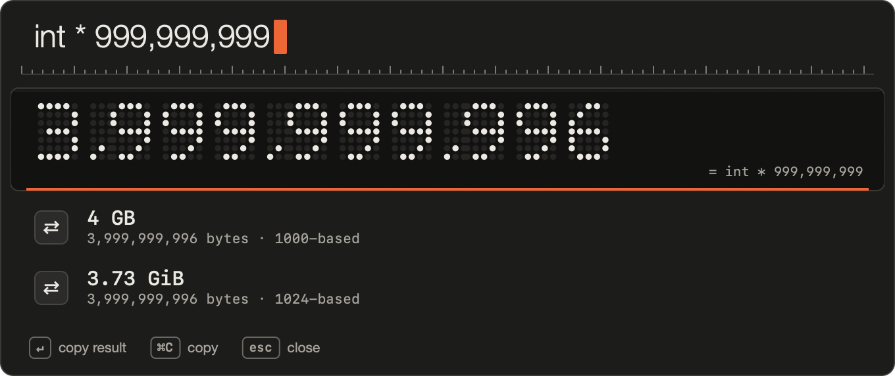

# Blink



I got fed up with Spotlight after the Golden Gate update, and the other replacements felt bloated. I just wanted something fast that launches apps and searches files. So I made this. That's it.

I'm a programmer, so I also built in the calculations I actually use: `int * 999,999,999`, `2.2gb * 0.6`, `255 to hex`, `1 << 8`, `192.168.1.0/24`. And yes, this is vibe coded. I don't know Swift, and I'm admitting it. Claude Code wrote the code.

| Key | What it does |
|---|---|
| `⌘Space` | Open Blink |
| `↵` | Open, or copy the result |
| `⌘↵` | Show in Finder |
| `⌘C` | Copy path |
| `⌘T` | Open in terminal |
| `⌘⌫` | Move to Trash |
| `⌘Z` | Undo Trash |
| `↑` | Calculator history, in an empty bar |
| Tap `⌘` | Settings |

```sh
git clone https://github.com/srinathshrestha/blink.git && cd blink && ./build.sh && open ~/Applications/Blink.app
```

Turn off Spotlight's `⌘Space` first: System Settings → Keyboard → Keyboard Shortcuts → Spotlight.

MIT license.
