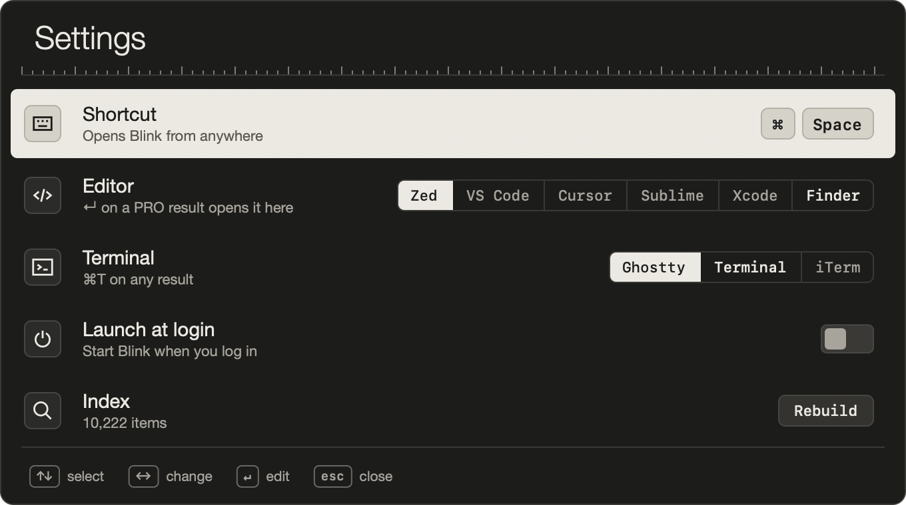

# Blink

A fast, minimal Spotlight replacement for macOS, with a programmer's calculator built in.

Press a hotkey, type, act, gone. No account, no telemetry, no plugins.


## What it does

- **Launch apps and find files.** Fuzzy search over apps and everything under your home folder and external drives. It keeps its own in-memory index and doesn't use Spotlight.
- **Open projects in your editor.** Folders with a `.git`, `package.json`, `Cargo.toml` and similar open in Zed, VS Code, Cursor, Sublime or Xcode.
- **Calculate like a programmer.**

| Type | Get |
|---|---|
| `int * 999,999,999` | 3,999,999,996, 4 GB, 3.73 GiB |
| `2.2gb * 0.6` | 1.32 GB |
| `5 gb at 100 mbps` | 6m 40s |
| `0xff & 0x0f`, `1 << 8`, `6 xor 3` | bit math, with hex and binary rows |
| `255 to hex`, `-1 to hex 8bit`, `0xff as int8` | bases and two's complement |
| `sizeof(long long)`, `uint16_t max`, `double epsilon` | C and C++ types |
| `1730000000 to date`, `2026-11-01 to unix` | epoch time |
| `192.168.1.0/24` | hosts, mask, range, broadcast |
| `#ff8800`, `65 to char`, `10!`, `gcd(12,18)` | colors, ASCII, math |

## Keys

| Key | Action |
|---|---|
| `↵` | Open, launch, or copy the result |
| `⌘↵` | Show in Finder |
| `⌘C` | Copy the path |
| `⌘T` | Open a terminal there |
| `⌘⌫` | Move to Trash (`⌘Z` restores it) |
| `↑` in an empty bar | Calculator history |
| Tap `⌘`, or `⌘,` | Settings |

Search filters: `d: name` folders, `f: name` files, `a: name` apps, `~/path` or `/path` to browse.



## Install

Requires an Apple Silicon Mac. Built and tested only on macOS 27; the package declares macOS 13 as its minimum, but older versions are untested.

**From source** (needs the Xcode Command Line Tools):

```sh
git clone https://github.com/srinathshrestha/blink.git
cd blink
./build.sh        # installs to ~/Applications/Blink.app
open ~/Applications/Blink.app
```

**From a release:** download the zip from [Releases](https://github.com/srinathshrestha/blink/releases) and move `Blink.app` to Applications. The app isn't notarized by Apple, so macOS will warn you. To open it anyway: System Settings → Privacy & Security → Open Anyway.

**To use `⌘Space`:** Blink's default hotkey is `⌘Space`, which Spotlight also uses. Turn off Spotlight's shortcut in System Settings → Keyboard → Keyboard Shortcuts → Spotlight, or pick another hotkey in Blink's settings.

macOS may ask for access to folders and removable drives. Blink only reads file names, and works with fewer results if you decline.

## Status

Early release from one developer's Mac. Expect rough edges, and please open an issue if something breaks.

## Design

The design rules and the reasoning behind them are in [DESIGN.md](DESIGN.md).

## License

[MIT](LICENSE)
